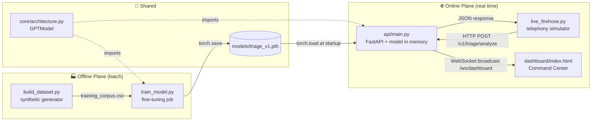
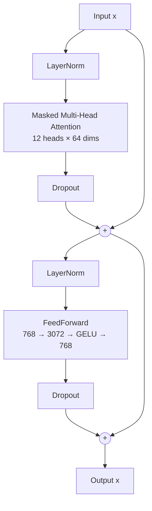
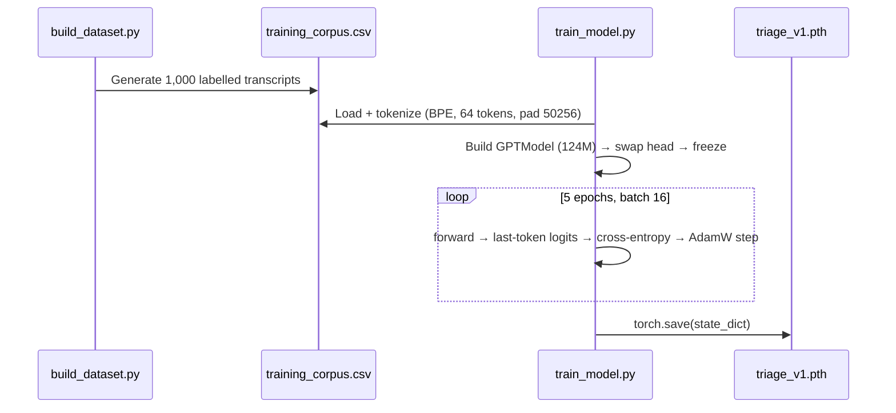
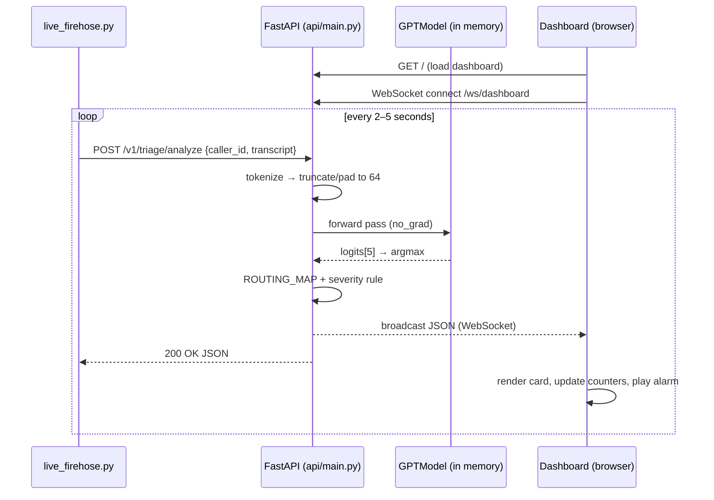

# 🚨 Emergency Dispatch Triage Service

A real-time, AI-assisted 911 call triage system. Incoming call transcripts are classified by a **GPT-2-style decoder-only Transformer** (written from scratch in PyTorch) into one of five dispatch departments. Each result is flagged for severity and pushed to a live command-center dashboard over WebSockets.

```
Caller transcript  ──►  FastAPI  ──►  Transformer classifier  ──►  Routing + severity  ──►  Live dashboard
```

> ⚠️ **Educational / prototype project.** The model is trained on a small, synthetic, template-generated corpus. It is **not** suitable for real emergency dispatch.

---

## 📑 Table of Contents

1. [Features](#-features)
2. [Project Structure](#-project-structure)
3. [Architecture Design](#-architecture-design)
4. [Theory: How the Model Works](#-theory-how-the-model-works)
5. [Model Contribution: What the AI Actually Does](#-model-contribution-what-the-ai-actually-does)
6. [End-to-End Workflow](#-end-to-end-workflow)
7. [Setup & Installation](#-setup--installation)
8. [How to Activate (Run the System)](#-how-to-activate-run-the-system)
9. [How to Test](#-how-to-test)
10. [API Reference](#-api-reference)
11. [Configuration Reference](#-configuration-reference)
12. [Known Limitations & Future Work](#-known-limitations--future-work)

---

## ✨ Features

- **From-scratch Transformer**: multi-head causal self-attention, GELU feed-forward, LayerNorm and residual connections, implemented by hand in `core/architecture.py`.
- **Transfer-learning-style fine-tuning**: the backbone is frozen and only the last Transformer block, the final LayerNorm and a new 5-class head are trained.
- **Low-latency inference API**: the model is loaded into memory once at startup and serves requests over HTTP.
- **Live command-center dashboard**: WebSocket push, per-department counters, a critical-call counter and audio alarms.
- **Telephony simulator**: a "firehose" that sends realistic-looking 911 calls to the API every 2–5 seconds.
- **Single source of truth**: training and serving import the same model class, so the architecture can't drift between them.

---

## 📁 Project Structure

```
emergency-dispatch-service/
├── core/
│   └── architecture.py        # 🧠 The "brain": GPTModel, TransformerBlock, MultiHeadAttention, FeedForward, GELU
├── offline_jobs/
│   ├── build_dataset.py       # 🏭 Synthetic data warehouse: generates labelled transcripts
│   ├── training_corpus.csv    # 📊 Generated dataset (1,000 rows: label, transcript)
│   └── train_model.py         # 🏋️ Training pipeline: fine-tunes and exports the .pth artifact
├── models/
│   └── triage_v1.pth          # 📦 Trained weights (~548 MB state_dict)
├── api/
│   └── main.py                # 🌐 FastAPI service: REST inference + WebSocket broadcast + dashboard host
├── dashboard/
│   └── index.html             # 🖥️ "NEXUS DISPATCH" live command-center UI (Tailwind + vanilla JS)
├── stream_simulator/
│   └── live_firehose.py       # 📞 Simulated CAD/telephony stream that POSTs calls to the API
└── README.md
```

---

## 🏗 Architecture Design

The system has two planes. An **offline plane** builds data and trains the model. An **online plane** serves predictions in real time. The only things they share are the model code (`core/architecture.py`) and the trained artifact (`models/triage_v1.pth`).



### Component Responsibilities

| Component | Role | Real-world analogue |
|---|---|---|
| `build_dataset.py` | Builds labelled training transcripts from templates | Data warehouse extract (Snowflake, Azure SQL) |
| `train_model.py` | Fine-tunes the Transformer and exports weights | Scheduled ML training job (Airflow, SageMaker) |
| `core/architecture.py` | Defines the network, shared by training and serving | Shared internal model library |
| `models/triage_v1.pth` | Versioned model artifact | Model registry (MLflow, S3) |
| `api/main.py` | Stateless inference microservice and event broadcaster | Production ML serving tier |
| `live_firehose.py` | Generates live call traffic | CAD / telephony / speech-to-text feed |
| `dashboard/index.html` | Real-time operator view | Dispatch center wallboard |

### Key Design Decisions

1. **Model loaded once at startup** (`@app.on_event("startup")`). Each request then costs only a forward pass, with no disk I/O.
2. **Push, not poll**: the dashboard keeps one WebSocket open, and the API broadcasts every triage decision to all connected clients right away.
3. **Fixed-length input (64 tokens)**: every transcript is truncated or padded to 64 tokens, so training and inference see the same input shape.
4. **Rules layer on top of ML**: the model only predicts the *department*. The *severity* is a deterministic business rule applied after the prediction, which keeps it auditable and easy to change.

---

## 📚 Theory: How the Model Works

### 1. Tokenization: Byte-Pair Encoding (BPE)

Transcripts are tokenized with OpenAI's **GPT-2 BPE tokenizer** (`tiktoken.get_encoding("gpt2")`), which has a 50,257-token vocabulary. BPE splits text into frequent sub-word units:

```
"engulfed in flames" → ["eng", "ulf", "ed", " in", " flames"] → [1516, 4754, 276, 287, 16209]
```

Sequences are cut or padded to **64 tokens**. Token `50256` (`<|endoftext|>`) is the padding token.

### 2. Embeddings

Each token ID becomes a 768-dim vector, and a learned **positional embedding** is added so the model knows word order:

```
x = TokenEmbedding(ids) + PositionalEmbedding(0..63)      # shape: [batch, 64, 768]
```

### 3. Transformer Block (×12)

Each block uses the **pre-LayerNorm** design from GPT-2:

```
x = x + Dropout( MultiHeadAttention( LayerNorm(x) ) )
x = x + Dropout( FeedForward( LayerNorm(x) ) )
```



#### a) Scaled Dot-Product Causal Self-Attention

Each token is projected into a **Query**, a **Key** and a **Value**. Attention weights measure how much each token should "look at" every earlier token:

$$
\text{Attention}(Q,K,V) = \text{softmax}\left(\frac{QK^\top}{\sqrt{d_k}} + M\right)V
$$

- $d_k = 64$ (768 / 12 heads). Dividing by $\sqrt{d_k}$ keeps the softmax from saturating.
- $M$ is the **causal mask**: an upper-triangular matrix filled with $-\infty$, so token *i* can only attend to tokens ≤ *i*.
- With **12 heads**, the model can learn 12 different relationship patterns in parallel (for example "subject ↔ verb" or "weapon ↔ action").

#### b) Feed-Forward Network

A per-token MLP that expands to 4× width and projects back down:

$$
\text{FFN}(x) = W_2 \cdot \text{GELU}(W_1 x + b_1) + b_2
$$

#### c) GELU Activation

The tanh approximation used by GPT-2:

$$
\text{GELU}(x) \approx 0.5x\left(1 + \tanh\left(\sqrt{2/\pi}\,(x + 0.044715x^3)\right)\right)
$$

#### d) Residual Connections + LayerNorm

The residual (shortcut) paths let gradients pass through deep stacks without vanishing. LayerNorm keeps activations well scaled.

### 4. Why Use the *Last* Token for Classification?

Because of the causal mask, **the last position is the only one that has attended to the entire sequence**. Its final hidden state is a summary of the whole transcript. The classifier reads only that position:

```python
logits = model(x)[:, -1, :]          # [batch, 5]
```

### 5. Classification Head & Loss

The original language-model head (`768 → 50,257` vocab) is **replaced** with a small classification head (`768 → 5`). Training minimizes **cross-entropy**:

$$
\mathcal{L} = -\sum_{c=0}^{4} y_c \log\left(\text{softmax}(z)_c\right)
$$

The optimizer is **AdamW** (Adam with decoupled weight decay), with `lr = 5e-4`.

### 6. Partial Fine-Tuning (Freezing)

```python
for p in model.parameters():          p.requires_grad = False   # freeze everything
model.out_head = nn.Linear(768, 5)                               # new head (trainable)
for p in model.trf_blocks[-1].parameters(): p.requires_grad = True   # unfreeze last block
for p in model.final_norm.parameters():     p.requires_grad = True   # unfreeze final norm
```

| Part | Parameters | Trainable? |
|---|---:|:---:|
| Token embedding (50,257 × 768) | ~38.6 M | ❄️ |
| Positional embedding (1,024 × 768) | ~0.8 M | ❄️ |
| Transformer blocks 1–11 | ~77.9 M | ❄️ |
| Transformer block 12 | ~7.1 M | ✅ |
| Final LayerNorm | 1,536 | ✅ |
| Classification head (768 × 5 + bias) | 3,845 | ✅ |
| **Total** | **~124.4 M** | **~7.1 M trainable (~5.7%)** |

Training only the top layers makes training much cheaper and lowers the risk of overfitting on a small dataset.

---

## 🤖 Model Contribution: What the AI Actually Does

The model is responsible for **one decision: which department handles the call?** Everything around it is deterministic code.

| Responsibility | Done by | Learned or rule? |
|---|---|---|
| Understand free-text transcript | Transformer | 🧠 Learned |
| Pick a department (5 classes) | Transformer + head | 🧠 Learned |
| Map class index → department name | `ROUTING_MAP` | 📏 Rule |
| Severity flag (HIGH / STANDARD) | `predicted_idx in [1, 2, 4]` | 📏 Rule |
| Delivery to dashboard and caller | FastAPI + WebSocket | ⚙️ Infrastructure |

### Class Labels

| Index | Department | Severity flag | Example training phrase |
|:---:|---|:---:|---|
| 0 | `MEDICAL` | ℹ️ Standard | "collapsed and is not breathing" |
| 1 | `FIRE` | 🚨 **High** | "is engulfed in flames" |
| 2 | `VIOLENT CRIME` | 🚨 **High** | "is waving a knife at the cashier" |
| 3 | `NON-VIOLENT CRIME` | ℹ️ Standard | "had its windows smashed in overnight" |
| 4 | `RESCUE & HAZMAT` | 🚨 **High** | "has a massive chemical spill leaking yellow gas" |

### What the Model Has to Learn

Every training transcript follows the same template:

```
"Emergency {location}, someone {scenario}. {urgency}"
```

The **location** and **urgency** parts are random noise and don't depend on the label (for example, "I'm hiding, please be quiet" shows up in fire calls too). Only the **scenario** carries the signal. So the model has to learn to:

- **Ignore** distractors such as location names and panic phrases.
- **Attend to** the semantic core: words like *flames*, *knife*, *chest pains*, *chemical spill*, *spray painted*.

---

## 🔄 End-to-End Workflow

### Phase A: Offline (one-time or scheduled)



### Phase B: Online (real time)



### Request Lifecycle (inside the API)

1. **Validate**: Pydantic checks that the body has `caller_id: str` and `transcript: str`.
2. **Encode**: GPT-2 BPE turns the text into token IDs, which are then cut or padded to 64.
3. **Infer**: a forward pass runs under `torch.no_grad()` and the last-token logits go through `argmax`.
4. **Route**: the class index is mapped to a department name, and the severity rule is applied.
5. **Broadcast**: the payload is sent to every connected dashboard socket.
6. **Respond**: the same payload is returned to the HTTP caller.

---

## 🛠 Setup & Installation

### Prerequisites

- Python **3.10+** (the code uses `list[WebSocket]` type hints)
- ~2 GB free RAM (the 124M-parameter model in fp32)
- Optional: a CUDA GPU. Training and inference pick it up automatically.

### Install

```bash
cd emergency-dispatch-service

python3 -m venv .venv
source .venv/bin/activate          # Windows: .venv\Scripts\activate

pip install torch tiktoken pandas fastapi "uvicorn[standard]" pydantic requests
```

> 💡 `uvicorn[standard]` includes the `websockets` library, which the dashboard needs.

Optional `requirements.txt`:

```text
torch>=2.0
tiktoken
pandas
fastapi
uvicorn[standard]
pydantic
requests
```

> ⚠️ **Run every command from the project root.** The scripts use relative paths such as `models/triage_v1.pth`, `offline_jobs/training_corpus.csv` and `dashboard/index.html`.

---

## ▶️ How to Activate (Run the System)

### Step 1: (Optional) Regenerate the dataset

```bash
python offline_jobs/build_dataset.py
# → Training corpus compiled: 1000 records saved to offline_jobs/training_corpus.csv
```

### Step 2: (Optional) Retrain the model

Skip this step if `models/triage_v1.pth` already exists.

```bash
python offline_jobs/train_model.py
# → Initializing training pipeline on cpu...
# → Epoch 1/5 | Average Loss: ...
# → Artifact exported successfully to models/triage_v1.pth
```

> ⏱ Expect a few minutes on GPU and longer on CPU.

### Step 3: Start the API server

```bash
uvicorn api.main:app --host 127.0.0.1 --port 8000
```

Wait for this line:

```
TriageAPI - INFO - Model mounted and ready for inference.
```

### Step 4: Open the dashboard

Go to **http://127.0.0.1:8000/**

- The connection indicator should turn green ("Firehose Socket: ONLINE").
- Click the **audio toggle** button to enable alarms. Browsers block audio until the user interacts with the page.

### Step 5: Start the live call stream

In a **second terminal** (with the venv activated):

```bash
python stream_simulator/live_firehose.py
```

```
FIREHOSE - Incoming Call: CALL-7XK2QA - 'Emergency at Jasper Ave, there is a guy with a knife threatening people. Send units!'
FIREHOSE - API ROUTING DECISION: VIOLENT CRIME [🚨 HIGH SEVERITY]
```

New call cards should now appear on the dashboard in real time. 🎉

### Stopping

Press `Ctrl+C` in each terminal.

---

## 🧪 How to Test

### 1. Health check: is the model loaded?

```bash
curl -s -X POST http://127.0.0.1:8000/v1/triage/analyze \
  -H "Content-Type: application/json" \
  -d '{"caller_id":"TEST-001","transcript":"Emergency on Jasper Ave, someone is engulfed in flames. Send help now!"}'
```

Expected response (`200 OK`):

```json
{
  "caller_id": "TEST-001",
  "assigned_department": "FIRE",
  "severity_flag": true,
  "transcript": "Emergency on Jasper Ave, someone is engulfed in flames. Send help now!"
}
```

A `503 {"detail":"Model not loaded"}` response means the `.pth` file failed to load. Check the server log and confirm you launched from the project root.

### 2. Smoke test for each class

```bash
for t in \
  "Emergency at the LRT station, someone collapsed and is not breathing. Please hurry!" \
  "Emergency on Jasper Ave, someone has heavy black smoke pouring out. Send help now!" \
  "Emergency at the West Edmonton Mall, someone is waving a knife at the cashier. Please hurry!" \
  "Emergency in a residential garage, someone was broken into and my bike is missing. It looks really bad." \
  "Emergency at the industrial park, someone has a massive chemical spill leaking yellow gas. We are evacuating now."
do
  curl -s -X POST http://127.0.0.1:8000/v1/triage/analyze \
    -H "Content-Type: application/json" \
    -d "{\"caller_id\":\"SMOKE\",\"transcript\":\"$t\"}" | python -m json.tool
done
```

Expected departments, in order: `MEDICAL`, `FIRE`, `VIOLENT CRIME`, `NON-VIOLENT CRIME`, `RESCUE & HAZMAT`.

### 3. Interactive API docs (Swagger)

FastAPI generates these automatically:

- Swagger UI: **http://127.0.0.1:8000/docs**
- ReDoc: **http://127.0.0.1:8000/redoc**

Use **"Try it out"** on `POST /v1/triage/analyze`.

### 4. Offline accuracy evaluation

Save as `scratch_eval.py` in the project root and run `python scratch_eval.py`:

```python
import torch, torch.nn as nn, tiktoken, pandas as pd
from core.architecture import GPTModel

cfg = {"vocab_size": 50257, "context_length": 1024, "emb_dim": 768,
       "n_heads": 12, "n_layers": 12, "drop_rate": 0.1, "qkv_bias": True}
model = GPTModel(cfg); model.out_head = nn.Linear(768, 5)
model.load_state_dict(torch.load("models/triage_v1.pth", map_location="cpu"))
model.eval()

tok = tiktoken.get_encoding("gpt2")
df = pd.read_csv("offline_jobs/training_corpus.csv")

def encode(t):
    ids = tok.encode(t)[:64]
    return ids + [50256] * (64 - len(ids))

correct = 0
with torch.no_grad():
    for i in range(0, len(df), 64):
        batch = df.iloc[i:i+64]
        x = torch.tensor([encode(t) for t in batch.transcript])
        pred = model(x)[:, -1, :].argmax(-1)
        correct += (pred == torch.tensor(batch.label.values)).sum().item()
print(f"Accuracy: {correct/len(df):.2%}")
```

> 📌 This scores the model on the **training** data, so it is a sanity check, not a measure of how well it generalizes. For a fair estimate, regenerate a separate CSV with a different random seed and evaluate on that instead.

### 5. WebSocket test (no browser)

```bash
pip install websocat   # or: brew install websocat
websocat ws://127.0.0.1:8000/ws/dashboard
# Now send a curl request from another terminal; the JSON payload appears here.
```

### 6. Load test (optional)

```bash
pip install locust
```

Then write a small `locustfile.py` that POSTs to `/v1/triage/analyze` and measures p50/p95 latency and throughput.

---

## 📡 API Reference

### `POST /v1/triage/analyze`

Classifies a call transcript and broadcasts the result to the dashboard.

**Request body**

| Field | Type | Description |
|---|---|---|
| `caller_id` | `string` | Unique call identifier (e.g. `CALL-AB12CD`) |
| `transcript` | `string` | Speech-to-text transcript of the call |

**Response `200`**

| Field | Type | Description |
|---|---|---|
| `caller_id` | `string` | Copied from the request |
| `assigned_department` | `string` | One of `MEDICAL`, `FIRE`, `VIOLENT CRIME`, `NON-VIOLENT CRIME`, `RESCUE & HAZMAT` |
| `severity_flag` | `bool` | `true` for FIRE, VIOLENT CRIME, RESCUE & HAZMAT |
| `transcript` | `string` | Copied from the request |

**Errors**: `422` for a malformed body, `503` if the model is not loaded.

### `WS /ws/dashboard`

Server-to-client stream. Each message is the JSON payload described above.

### `GET /`

Serves the command-center dashboard (`dashboard/index.html`).

---

## ⚙️ Configuration Reference

Model hyperparameters (identical in `train_model.py` and `api/main.py`):

| Key | Value | Meaning |
|---|---|---|
| `vocab_size` | 50257 | GPT-2 BPE vocabulary |
| `context_length` | 1024 | Max positions (only 64 are used) |
| `emb_dim` | 768 | Hidden size |
| `n_heads` | 12 | Attention heads (64 dims each) |
| `n_layers` | 12 | Transformer blocks |
| `drop_rate` | 0.1 | Dropout (turned off by `model.eval()` at inference) |
| `qkv_bias` | True | Bias on Q/K/V projections |

Training hyperparameters:

| Setting | Value |
|---|---|
| Max sequence length | 64 tokens |
| Batch size | 16 |
| Epochs | 5 |
| Optimizer | AdamW, lr = 5e-4 |
| Loss | Cross-entropy (5 classes) |
| Device | CUDA if available, else CPU |

> ⚠️ If you change `cfg` in one file, change it in the other too, or `load_state_dict` will fail. A good next refactor is to move `cfg` into `core/`.

---

## ⚠️ Known Limitations & Future Work

These are honest notes on the current prototype, useful for anyone extending it:

| # | Observation | Impact | Suggested fix |
|---|---|---|---|
| 1 | **No pretrained weights are loaded.** `GPTModel(cfg)` starts from random weights, then everything except the top block is frozen. | The frozen embeddings and the first 11 blocks are random features. The model still fits the synthetic data, but language understanding is minimal. | Load OpenAI GPT-2 (124M) weights before freezing, or unfreeze more layers. |
| 2 | **Classification reads the last *padded* position.** Short transcripts end in `<\|endoftext\|>` tokens, and the prediction comes from position 63. | Works, because causal attention still sees the whole sentence, but it is less clean than reading the last *real* token. | Index the final non-pad token, or use an attention mask. |
| 3 | **MEDICAL is flagged Standard severity.** "Not breathing" or cardiac arrest gets `severity_flag = false`. | Questionable from a clinical point of view. | Rethink the severity policy, or train a separate severity model. |
| 4 | **Train/serve distribution shift.** The simulator's phrasing ("massive car crash, someone is trapped") does not appear in the training templates. | Live predictions can be unreliable. | Add more varied training data, or real (anonymized) transcripts. |
| 5 | **No train/validation split or metrics** in `train_model.py`. | No visibility into overfitting. | Add a hold-out set, an accuracy/F1 score and a confusion matrix. |
| 6 | **No confidence score is returned.** | Low-confidence calls can't be escalated to a human. | Return `softmax` probabilities and route anything below a threshold to manual review. |
| 7 | **No dependency file, tests or Dockerfile.** | Harder to reproduce. | Add `requirements.txt`, `pytest` tests (FastAPI `TestClient`) and a `Dockerfile`. |
| 8 | `@app.on_event("startup")` is deprecated in recent FastAPI versions. | Deprecation warnings. | Switch to the `lifespan` context manager. |
| 9 | The 548 MB weights file is stored in the repo. | Bloats the repo and clones. | Use Git LFS or a model registry. |
| 10 | A dashboard socket that closes mid-broadcast can raise inside `broadcast()`. | A request could fail. | Wrap each send in try/except and drop dead connections. |

### Roadmap Ideas

- 🎙 Speech-to-text front end (e.g. Whisper), so the system takes raw audio
- 📍 Entity extraction for location, number of victims and weapons
- 📈 Prometheus metrics and latency tracing
- 🧑‍⚖️ Human-in-the-loop overrides that feed back into retraining
- 🐳 Docker Compose for API + simulator + dashboard

---

## 🙏 Acknowledgements

- Transformer architecture: Vaswani et al., *"Attention Is All You Need"* (2017)
- GPT-2: Radford et al., *"Language Models are Unsupervised Multitask Learners"* (2019)
- From-scratch GPT implementation style inspired by Sebastian Raschka's *Build a Large Language Model (From Scratch)*
